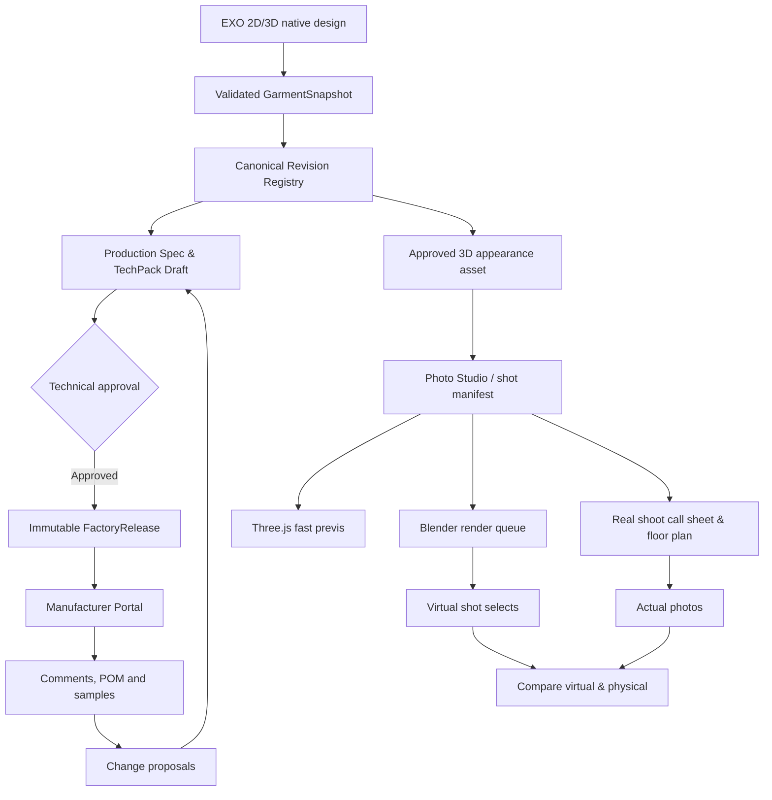

# EXO all-in-one | implementation backlog and first sprint handoff

**Status:** proposed engineering work; no implementation or deployment is claimed. **Cutoff:** 17 October 2026. Linked to `EXO_ALL_IN_ONE_IMPLEMENTATION_BLUEPRINT_30_PAGES.md`, `MANUFACTURER_PORTAL_BLUEPRINT.md`, and `PHOTO_STUDIO_BLUEPRINT.md`. All production and photoshoot data must derive from a stable garment revision. Keep the separate native EXO V2 document and protected V1 environment safe during prototyping.

## A. Architecture decisions to make before engineering

1. **Canonical garment snapshot.** Define a JSON Schema with `schemaVersion`, `sourceSystem`, `styleId`, `garmentRevisionId`, `contentHash`, `canonicalUnits`, stable panel/edge/measurement IDs, factual manufacturing fields and optional immutable visual asset refs. The source adapters must report unsupported fields; they must not invent grade and hardware geometry. Compare data from `src/core/measurements.js`, `src/core/factoryPackage.js` and the native Rust source before designating an authoritative field.
2. **Local authoring / collaborative cloud.** Keep the macOS native Rust editor and existing Vite client intact initially. A source snapshot can be uploaded explicitly to an authenticated backend; the cloud owns collaboration, approvals, materials/release histories and external access. Remote factories never connect to the user's local Rust port.
3. **Modular monolith before distributed microservices.** For initial deployment, define bounded backend modules for `identity`, `organizations`, `styles`, `releases`, `comments`, `proposals`, `samples`, `orders`, `shoots`, `renderJobs`, `mediaAssets`, `audit`, and `notifications`. PostgreSQL for transactions, object storage for files, a durable job queue for render/export. Keep all human actions attributable.
4. **One source / multiple release streams.** A `GarmentRevision` is source engineering state; a `FactoryRelease` is an approved immutable manufacturing agreement; a `ShootRevision` is creative presentation. A camera change must not alter a cutting file, and a sample observation must not rewrite R02 without authorized review.
5. **Consent and security.** External collaboration requires tenant and object permissions, immutable release snapshots, invitation scoping, expiring asset URLs, file safety checks, audit, encrypted transport and tested restores. A UI-hidden field is not a security boundary.
6. **Rendering authority.** Keep Three.js as a fast preview and Blender Cycles as a controlled final-render path. A finished render must not be described as a validated physical fit or a physically faithful studio-light metering prediction.

## B. Working model: master architecture



## C. First development epics and concrete deliverables

| Ticket | Priority | Depends on | Concrete implementation | Acceptance / test evidence |
|---|---|---|---|---|
| EXO-101 | P0 | none | Baseline source contract and owned draft fixture garment | Stable material/panel/size/edge IDs, checked units; hashes survive save/open |
| EXO-102 | P0 | 101 | Versioned JSON Schema and source adaptor diagnostics | Same fixture normalized from draft and native readback, unsupported fields listed |
| EXO-103 | P0 | 102 | Immutable revision storage, object hashes and lineage | Saving a new draft never changes an old snapshot's hashes |
| EXO-104 | P0 | 103 | POM/BOM/production export to web projection | Web tables match existing factory package values, not retyped placeholders |
| EXO-105 | P0 | 103 | Organization/member/release-scope ACL API | Factory B cannot read Factory A's style, files, notifications or search results |
| EXO-106 | P0 | 104,105 | Read-only Tech Pack website and revision header | Authorized manufacturer opens exact R01 sections on desktop/mobile |
| EXO-107 | P0 | 106 | Contextual comments: `POM`, `edge`, `BOM`, `photo`, `seam` | Comment pinned to size-L cuff remains resolvable across a new working draft |
| EXO-108 | P0 | 107 | File upload and immutable sample evidence | Original/photo markup separate; authenticated scoped downloads only |
| EXO-109 | P0 | 107,103 | Typed factory change proposal & reviewer inbox | Proposed number never writes authoritative POM until approved into a draft |
| EXO-110 | P0 | 103,104,109 | Release diff / approval / acknowledgement | R01/R02 frozen, signed reviewer, manufacturer acknowledgement, replayable export |
| EXO-111 | P1 | 110 | PDF/ZIP static factory release fallback | Stamp every output with exact release ID and source manifest digest |
| EXO-112 | P1 | 110 | Production order and factory milestones | Actuals are sourced actor events, late events and duplicated uploads idempotent |
| EXO-113 | P1 | 108,112 | Sample POM report, fit observations and QC tasks | Measurements explicitly marked physical/proposed/approved, size/colorway linked |
| EXO-114 | P0 | 103 | `ShootProject` + `Shot` manifest model and camera/lighting persistence | Opening saved SH-01 replays identical camera and stage positions |
| EXO-115 | P0 | 114 | Studio preset builder from existing Stage Library | Neutral cove preset with eight shot placeholders; no stage catalog edits |
| EXO-116 | P0 | 114,115 | Three.js camera viewport + storyboard contact sheet | Reordering shots preserves shot IDs and settings; front/back/closeup preview |
| EXO-117 | P1 | 116 | 2D scaled floor plan, equipment and call sheet | Print gear/light/camera position map in metres with venue measurements |
| EXO-118 | P1 | 116 | Blender Cycles manifest compiler and isolated render worker | Same shot/camera/pose with expected garment topology in low/high quality output |
| EXO-119 | P1 | 118 | Render job queue, cancellation, hashes and revisions | Restart worker, cancelled jobs remain cancelled, outputs tied to source hash |
| EXO-120 | P1 | 118,117 | Side-by-side virtual and real photo comparison | Upload labeled SH-01 physical select without overwriting digital reference |
| EXO-121 | P1 | 104,110 | Grade/seam/cut release validity gates | Manufactured package blocks on truly invalid cut pieces and missing required POM |
| EXO-122 | P1 | 105,111 | Offline/mobile manufacturing handoff | Readable on 360 px; revocation/expired invite enforced on reconnect |
| EXO-123 | P1 | 105,118 | Compute quotas and licensed asset store | Only explicitly requested renders run; missing rights and source files block export |
| EXO-124 | P2 | 112 | Factory milestone/QC/lot integration and actual quantity reporting | Every production event names release/lot/actor and supports replay |

## D. Suggested implementation file boundaries

These paths are proposed and need team approval; they do not yet exist. Keep early work isolated from the actively changing large `src/App.jsx`.

```text
src/core/exoSnapshotAdapter.js
src/core/exoSnapshotSchema.js
src/components/ProductionHub/
src/components/ProductionHub/StyleSummary.jsx
src/components/ProductionHub/TechPackViewer.jsx
src/components/ProductionHub/FactoryThreadDrawer.jsx
src/components/ProductionHub/ChangeProposalReview.jsx
src/components/PhotoStudio/
src/components/PhotoStudio/ShotBoard.jsx
src/components/PhotoStudio/PhotoViewport.jsx
src/components/PhotoStudio/LightRigInspector.jsx
src/components/PhotoStudio/PhysicalSetPlan.jsx
src/components/PhotoStudio/RenderQueue.jsx
services/exo-collaboration/src/{auth,styles,releases,comments,proposals,samples,orders,shoots,render-jobs}/
services/exo-collaboration/migrations/
integrations/blender/photo-studio/
schemas/exo/{garment-snapshot,techpack-release,shoot-manifest}.schema.json
scripts/qa/factory-tenant-isolation.mjs
scripts/qa/techpack-release-roundtrip.mjs
scripts/qa/photo-shot-manifest-render.mjs
```

### Data interfaces (illustrative schema fields)

```json
{
  "FactoryRelease": {
    "id": "release-uuid", "styleId": "style-uuid",
    "sourceGarmentRevisionId": "garment-revision-uuid",
    "snapshotHash": "sha256-hex", "techPackSchemaVersion": 1,
    "status": "RELEASED", "sizeSetId": "sizeset-uuid",
    "approvedAt": "timestamp", "approvedBy": ["actor-uuid"],
    "allowedManufacturerOrganizationIds": ["organization-uuid"],
    "artifactIds": ["techpack-json", "approved-pdf", "factory-zip"]
  },
  "ChangeProposal": {
    "id": "proposal-uuid", "targetReleaseId": "release-uuid",
    "entityKind": "POM", "entityId": "cuff-opening",
    "sizeId": "L", "oldValueMm": 240, "proposedValueMm": 250,
    "status": "NEEDS_DESIGN_REVIEW", "submittedBy": "factory-actor-uuid"
  },
  "Shot": {
    "id": "shot-uuid", "shotNumber": "SH-008", "styleId": "style-uuid",
    "garmentAppearanceRevisionId": "appearance-revision-uuid",
    "sceneRevisionId": "neutral-cyc-revision", "poseRevisionId": "pose-uuid",
    "camera": {"focalLengthMm": 85, "sensorWidthMm": 36, "distanceM": 3.4},
    "lightRigId": "studio-threepoint-v2", "intent": "front-commerce",
    "status": "PLANNED", "renderJobIds": []
  }
}
```

Every identifier, timestamp, actor and string in these examples is illustrative. Actual JSON Schemas must validate type, bounds, version, units and authorization; final API routes may differ. Company-specific BOM materials, copyrighted assets and supplier financial data must not be returned to unauthorized shoot/public clients.

## E. First two user demos, with measurable end state

**Demo 1 — factory sample comment:** An EXO synthetic hoodie is exported as R01 from verified current source. Manufacturer A logs in and opens a measurement diagram. They post one photo and a new physical measurement for size L. Designer receives an issue anchored to that line, reviews an explicit proposed +10 mm change and accepts into a working draft. The system **does not** auto-release. After spec review, approver issues R02. Manufacturer A acknowledges R02, while R01 sample and comment remain attached to R01. A second organization receives 403 on every protected record and file. Browser back button, refresh and restart preserve states.

**Demo 2 — physical studio rehearsal:** A designer selects the same synthetic hoodie appearance asset, opens a neutral cyc preset, creates an eight-shot ecommerce list and saves SH-01 front, SH-02 back and SH-03 hardware detail. They move an 85 mm virtual camera, reposition key/fill/rim in metres, preview a storyboard and submit a low-resolution Cycles render. The resulting image and metadata link to frozen shot settings. The producer exports a floor plan/call sheet with camera stand, backdrop, studio dimensions and gear checklist. After the real shoot, photo SH-03 is uploaded and compared against the saved 3D reference without mutating it.

**Definition of success:** The two demos share a garment identity and source revision without mixing manufacturing authority and creative appearance edits. Their outputs remain reproducible after service restart and are readable to collaborators who have never installed EXO.

## F. Prioritize actual user discovery

Before a public factory beta, review one real patternmaker's approved size grading and cutter file workflow, one manufacturer that uses email or spreadsheets, and one photographer/producer with a real studio plan. Document where EXO's new fields map poorly to their existing terms. Pilot success should be measured in reduced clarification cycles, fewer stale revisions and better shoot setup predictability, rather than number of buttons or 3D preview quality alone.
